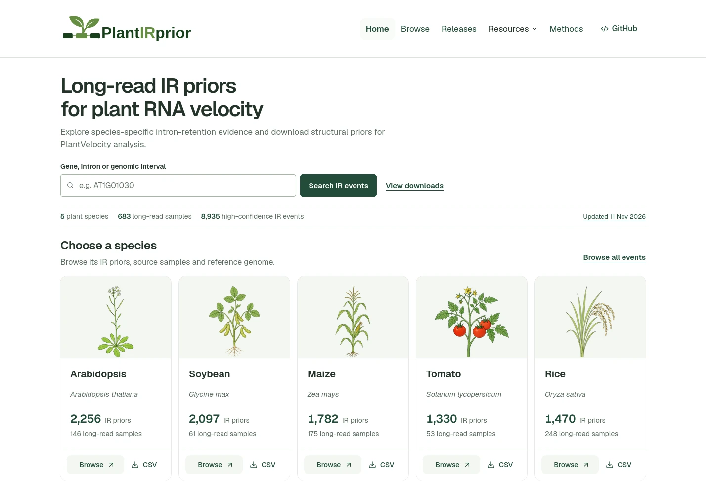

# PlantIRPrior

**Long-read-supported intron-retention priors for PlantVelocity.**

Browse plant intron-retention (IR) events and download reference-matched
structural priors for RNA velocity analysis. Each release includes long-read
evidence and source provenance.

[**Explore the resource →**](https://plantvelocityproject.github.io/PlantIRprior/) ·
[Download priors](https://plantvelocityproject.github.io/PlantIRprior/#resources) ·
[Methods](https://plantvelocityproject.github.io/PlantIRprior/#methods) ·
[Release history](https://plantvelocityproject.github.io/PlantIRprior/#releases)

**5 plant species · 683 long-read samples · 8,935 high-confidence IR events**

<p>
  <a href="https://plantvelocityproject.github.io/PlantIRprior/">
    
  </a>
</p>

## Find and use a prior

1. **Choose your reference.** [Browse IR events](https://plantvelocityproject.github.io/PlantIRprior/#catalogue)
   by species, gene or genomic interval. Check the
   [genome assembly and annotation](https://plantvelocityproject.github.io/PlantIRprior/#references)
   against those used in your analysis.
2. **Inspect and download.** Review event metrics and source samples, then
   [download](https://plantvelocityproject.github.io/PlantIRprior/#resources)
   a PlantVelo prior, an event table or the complete resource snapshot. Evidence
   bundles and provenance are available for tracing each release to its inputs.
3. **Continue with your analysis.** Use the matching prior with
   [PlantVelo](https://github.com/PlantVelocityProject/plantvelo) for counting,
   then follow [PlantVelocity](https://github.com/PlantVelocityProject/PlantVelocity)
   for downstream RNA velocity analysis.

> **Match species, assembly and annotation.** Each prior is specific to that
> combination. Keep its release identity and provenance with your analysis.

## Resource coverage

The bundled snapshot contains the following high-confidence events. Counts and
reference identities come from the [release manifest](website/data/releases/index.json),
last updated **11 November 2026**; the website provides the release history and
downloads for each version.

| Species | Samples | IR events |
| --- | ---: | ---: |
| [*Arabidopsis thaliana*](https://plantvelocityproject.github.io/PlantIRprior/#catalogue?species=ath) | 146 | 2,256 |
| [*Glycine max*](https://plantvelocityproject.github.io/PlantIRprior/#catalogue?species=gmx) | 61 | 2,097 |
| [*Oryza sativa*](https://plantvelocityproject.github.io/PlantIRprior/#catalogue?species=osa) | 248 | 1,470 |
| [*Solanum lycopersicum*](https://plantvelocityproject.github.io/PlantIRprior/#catalogue?species=sly) | 53 | 1,330 |
| [*Zea mays*](https://plantvelocityproject.github.io/PlantIRprior/#catalogue?species=zma) | 175 | 1,782 |

## From long reads to IR priors

Iso-seq, FLEP-seq and ONT reads are aligned to their matching reference genome
and interpreted against its gene annotation. The workflow classifies read–intron
evidence, pools compatible counts and selects high-confidence IR priors.


1. **Classify the evidence.** Reads support spliced, retained or
   retention-specific evidence. Retention-specific evidence is a subset of
   retained evidence. Conflicting and uninformative assignments are excluded
   from IR metrics.
2. **Pool compatible samples.** Combine counts within each **species × reference
   assembly × annotation** group. Informative counts equal retained plus spliced
   counts.
3. **Calculate metrics and select priors.** IR ratio is **retained / informative**;
   IR specificity is **retention-specific / retained**. Both metrics and all
   three read-count requirements must pass:

| Criterion | High-confidence threshold |
| --- | ---: |
| IR ratio | ≥ 0.20 |
| IR specificity | ≥ 0.70 |
| Retained reads | ≥ 5 |
| Informative reads | ≥ 10 |
| Spliced reads | ≥ 5 |

Thresholds are defined in [classification.json](configs/classification.json).
Released priors retain reference and annotation identities, source samples,
evidence and provenance. The website's
[interactive Methods page](https://plantvelocityproject.github.io/PlantIRprior/#methods)
explains the workflow in more detail.

## Agent-assisted resource updates

The IR agent turns an update request into a bounded workflow, monitors progress,
helps recover interrupted tasks and reports verified results. Scientific
processing uses the existing analysis tools with explicit parameters and
evidence checks.


- **Traceable discovery.** Metadata come from the original accession archive:
  NCBI, ENA, DDBJ or NGDC. The workflow covers curation, retrieval, alignment,
  evidence quantification and validation, pooling, and versioned delivery.
- **Bounded execution.** The default budget is **10 sample attempts per execution**,
  processed serially, with recorded task state for recovery.
- **Validated evidence.** Reuse requires valid contents, compatibility with the
  current scientific request and admission of the reference group.
- **Publication after review.** Ordinary updates accumulate evidence. **50 new
  valid samples per species/reference/annotation group** form a review checkpoint;
  publication requires an explicit request. The checkpoint neither automatically
  publishes a release nor sets a minimum for an explicit publication.
- **Versioned delivery.** Explicit publication validates and pools existing
  evidence, then delivers released resources and website data. Delivery failures
  can be repaired separately from scientific computation.

See the [IR agent skill](integrations/hermes/skills/ir-prior-update/SKILL.md) for
task operations and reporting rules, and
[aggregation.json](configs/aggregation.json) for the review and publication policy.

## Repository guide

| Location | Purpose |
| --- | --- |
| [website/](website/) | Static resource website, UI source, figures and published release data |
| [IR agent skill](integrations/hermes/skills/ir-prior-update/) | Update instructions, task operations and reporting rules |
| [scripts/](scripts/) | Workflow orchestration, validation, task interface and release delivery |
| [configs/](configs/) | Alignment parameters, evidence settings, classification thresholds and publication policy |

The website includes its runtime assets, local fonts and release data. To preview
it locally, serve the directory and open <http://localhost:8000>:

```bash
python3 -m http.server 8000 --directory website
```

For analysis software, continue to
[PlantVelo](https://github.com/PlantVelocityProject/plantvelo) and
[PlantVelocity](https://github.com/PlantVelocityProject/PlantVelocity).
