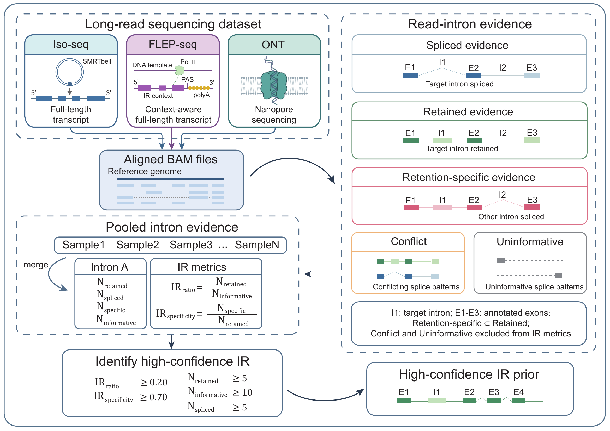
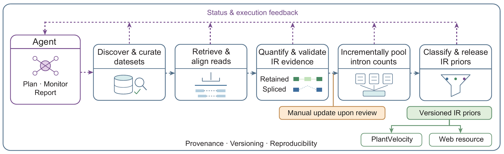

# PlantIRPrior

Agent-assisted curation of long-read-supported plant intron-retention (IR) priors,
with an interactive resource website for PlantVelocity.

PlantIRagent brings together the evidence workflow used to construct IR priors,
the **PlantIRPrior** resource website, and an IR agent that helps plan, monitor
and report resource updates. This repository provides the website and supporting
workflow materials for readers of the accompanying research.

[Release manifest](website/data/releases/index.json) ·
[IR agent skill](integrations/hermes/skills/ir-prior-update/SKILL.md) ·
[PlantVelo](https://github.com/PlantVelocityProject/plantvelo) ·
[PlantVelocity](https://github.com/PlantVelocityProject/PlantVelocity)

## From long reads to IR priors

Long-read datasets from Iso-seq, FLEP-seq and ONT are aligned to their matching
reference genome and interpreted against the corresponding gene annotation.
The workflow then:

1. **Classifies read–intron evidence.** Reads provide spliced, retained or
   retention-specific evidence. Retention-specific evidence is a subset of
   retained evidence; conflicting and uninformative assignments are excluded
   from IR metrics.
2. **Pools compatible evidence.** Counts are combined across samples within
   each species, reference assembly and annotation combination. Informative
   counts equal retained plus spliced counts.
3. **Calculates IR metrics.** IR ratio is retained / informative; IR specificity
   is retention-specific / retained.
4. **Selects high-confidence priors.** The current criteria require IR ratio
   ≥ 0.20, IR specificity ≥ 0.70, at least 5 retained reads, 10 informative reads
   and 5 spliced reads. The thresholds are recorded in
   [classification.json](configs/classification.json).

Released priors preserve their reference and annotation identities, source
samples, evidence and provenance so that users can select resources matching
their PlantVelocity analysis.

## PlantIR Prior website

The website supports browsing and filtering IR events, inspecting source samples
and reference versions, exploring release history, and downloading event tables,
PlantVelo priors and evidence bundles. Its Methods page presents the scientific
workflow interactively.

The bundled release snapshot contains **8,935 high-confidence IR events from
683 long-read samples** across five species:

| Species | Samples | High-confidence IR events |
| --- | ---: | ---: |
| *Arabidopsis thaliana* | 146 | 2,256 |
| *Glycine max* | 61 | 2,097 |
| *Oryza sativa* | 248 | 1,470 |
| *Solanum lycopersicum* | 53 | 1,330 |
| *Zea mays* | 175 | 1,782 |

All website runtime files, including local fonts, illustrations, interactive
components, animations and release data, are contained in [website/](website/).
The directory can be served by a static host. Website animations work without
the local development previews or reports.

## IR agent-assisted updates

The IR agent uses a dedicated skill and task interface to translate an update
request into a bounded workflow, inspect progress, help recover interrupted
tasks and report verified results. Scientific processing runs through the
existing analysis tools, with explicit parameters and evidence checks.

The update lifecycle covers dataset discovery and metadata curation, read
retrieval and alignment, evidence quantification and validation, incremental
pooling, and delivery of versioned IR priors to PlantVelocity and the website.
Source metadata are retrieved from the original archive: NCBI, ENA, DDBJ or
NGDC, according to the accession source.

Current execution and publication rules are:

- **Bounded execution:** the default budget is 10 sample attempts per execution,
  with serial processing and recorded task state for recovery.
- **Evidence validation:** reuse depends on valid contents, compatibility with
  the current scientific request, and admission of the reference group.
- **Manual publication:** ordinary updates accumulate evidence. 50 new valid
  samples per species/reference/annotation group form a review checkpoint;
  publication requires an explicit request. Reaching the checkpoint does not
  automatically publish a release.
- **Versioned delivery:** an explicit publication validates and pools existing
  evidence, then delivers the published resources and website data. Delivery
  failures can be repaired separately from scientific computation.

The diagram marks the publication decision as **Manual update upon review**.
The review checkpoint and manual publication policy are defined in
[aggregation.json](configs/aggregation.json) and the
[IR agent skill](integrations/hermes/skills/ir-prior-update/SKILL.md).

## Repository guide

| Location | Contents |
| --- | --- |
| [website/](website/) | Static resource website, UI source, figures and published website data |
| [integrations/hermes/skills/ir-prior-update/](integrations/hermes/skills/ir-prior-update/) | IR agent instructions, task operations and reporting rules |
| [scripts/](scripts/) | Task interface, scientific workflow orchestration, validation and release delivery |
| [configs/](configs/) | Alignment and evidence parameters, classification thresholds and publication policy |

